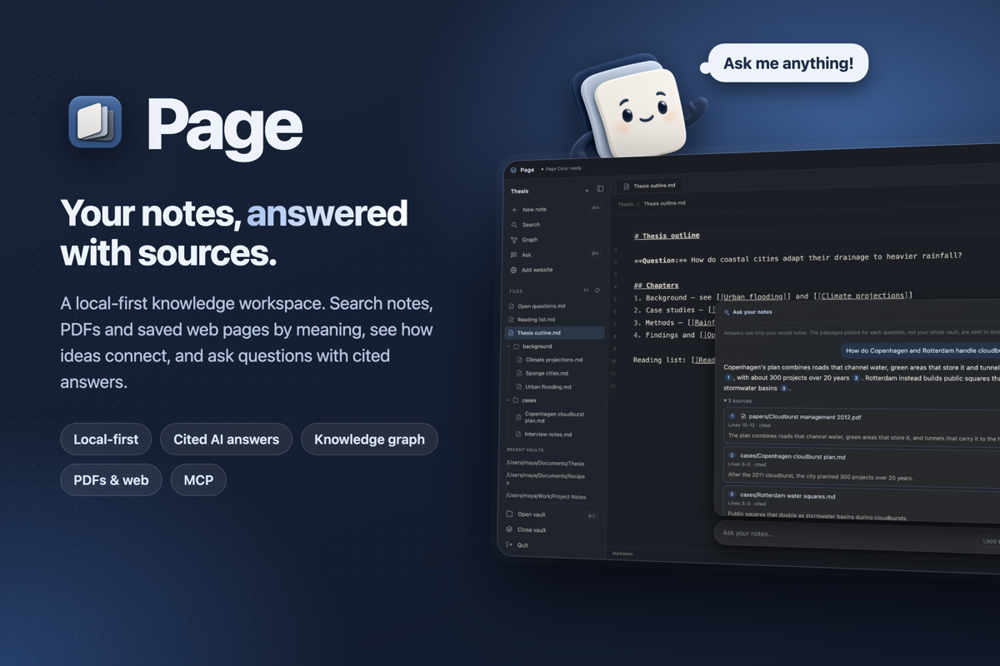

<p align="center">
  
</p>

# Page

**A local-first knowledge workspace for your notes, PDFs and saved web pages.**

Page keeps your notes as plain Markdown files in a folder you own. It shows how your
ideas connect, finds passages by meaning, and answers questions about what you've
written. Each answer cites the notes and lines it came from. When you ask a question,
Page sends the AI only the passages that matter, not your whole vault.

**Website:** [page-one-topaz.vercel.app](https://page-one-topaz.vercel.app/) ·
**Download:** coming soon (macOS)

## Features

- **Plain Markdown, in your folder.** Notes are ordinary `.md` files. Edit them in Page
  or any other editor; the files stay the source of truth. Page picks up changes made
  outside the app and helps you resolve conflicts.
- **More than Markdown.** PDFs, source code and text files in the vault folder become
  searchable, read-only knowledge. **Add website** saves a web page as a note.
- **Links and a knowledge graph.** Link notes with `[[wiki links]]`, follow backlinks,
  and explore an interactive graph beside the note you're reading.
- **Search by meaning.** A local model finds relevant passages, even inside PDFs, when
  the words don't match. Search runs on your Mac and sends nothing anywhere.
- **Ask your notes.** Press Cmd+K and ask a question. Page picks the relevant passages
  within a token budget you choose, sends only those to Google Gemini, and shows an
  answer with clickable citations.
- **See what you saved.** Each answer shows how many tokens Page sent compared with
  the matching passages it found.
- **Works with AI agents.** An MCP server gives tools like Claude Code and Claude
  Desktop the same search and cited context.
- **Friendly to start.** Finder-based vault and note pickers, a sample vault, a short
  intro tour, and a mascot who thinks while Page works and dances when an answer
  arrives.

## How it works

```
 your vault folder          Page Core (local, Python)                  Gemini
 ─────────────────          ─────────────────────────                  ──────
 Markdown notes   ──┐       1. index files into passages
 PDFs, code, text ──┼──▶    2. embed them with a local model    ──▶   question +
 saved web pages  ──┘       3. find passages by meaning               selected
                            4. pack the best ones into a budget       passages only
                               with sources                    ◀──    cited answer
```

1. **Index.** Page splits notes and other files into passages and keeps its metadata
   in SQLite, in a hidden `.page` folder inside the vault. Markdown stays the source
   of truth.
2. **Retrieve.** A local sentence-transformer model (`all-MiniLM-L6-v2`) and FAISS
   find the passages closest in meaning to the question.
3. **Optimize.** The context optimizer drops duplicates and weak matches, trims long
   passages to exact excerpts, and fits the rest into the token budget, keeping the
   path and line range of each passage.
4. **Answer.** Only the question and those passages go to Gemini. The answer cites
   them by number, and Page links each citation back to its source.

The desktop app talks to Page Core over a local API on `127.0.0.1`, protected by a
fresh session token each time it starts. The same engine powers the MCP server.

## Measured results

Measured on a benchmark of 40 held-out questions over 17 notes, with a 300-token budget:

| | Full vault | Page |
|---|---|---|
| Average context tokens | 2,606 | 267 (**89.7% less**) |
| Expected answer still in context | 100% | **100%** |
| Median local search time | | **193 ms** |

These numbers come from a small benchmark vault, and the savings depend on the vault.
Compared with simply sending every matching passage, Page's trimming saves less: a
median of about 21% on the same questions. On this small benchmark, plain top-5 search
does about as well as the optimizer. A learned neural reranker was also tested; it cut
more tokens but kept the answer for only 72.5% of questions, so it isn't the default.
Token counts are Page's estimate (UTF-8 bytes ÷ 3), not Gemini's billing tokenizer. See
[evaluation](docs/evaluation.md) for the method and full results.

## Built with

| Area | Tools |
|---|---|
| Desktop app | Tauri 2 (Rust), React 19, TypeScript, Vite, Tailwind CSS 4, CodeMirror, Cytoscape.js |
| Core engine | Python 3.12, FastAPI, SQLite, Sentence Transformers, FAISS, PyTorch, pypdf |
| AI | Google Gemini API, Model Context Protocol (MCP) |
| Website | React, Vite, deployed on Vercel |
| Tooling | npm workspaces, pytest, Vitest, ESLint, rustfmt, GitHub Actions |

## Getting started

Signed macOS downloads aren't available yet. To run Page from source on macOS
(Apple silicon, macOS 14 or later), install Python 3.12, Node.js 24, Rust and the
Xcode Command Line Tools, then from the repository root:

```sh
npm ci
python3.12 -m venv .venv
.venv/bin/python -m pip install -r packages/core/requirements-dev.txt -e packages/core
.venv/bin/python -m page_core.semantic prepare-model   # downloads the search model once
npm run tauri:dev
```

To ask questions, get a Gemini API key, click the key button in the ask box, paste it,
and choose **Save Key**. Everything else works without a key or an internet connection.

To use Page from Claude Code:

```sh
claude mcp add page -- /path/to/page/.venv/bin/python -m page_core.mcp_server --vault /path/to/vault
```

See [Developing Page](docs/development.md) for full setup, tests and Windows notes, and
[packaging](docs/packaging.md) to build the self-contained macOS app.

## Privacy

- Notes, files and the search index stay on your computer. No account is needed.
- Search and indexing run locally. Only a question and the passages selected for it
  are sent to Gemini, and only when you ask.
- Your Gemini key is stored in a private file in Page's settings folder (readable only
  by you), never in the vault.

## Project structure

```
apps/desktop/      Desktop app: React frontend (src/), Tauri shell (src-tauri/),
                   and the landing website (landing.html, src/landing/)
packages/core/     Page Core, the Python engine (import name page_core)
integrations/      MCP integration notes
benchmarks/        Benchmark data and results
training/          Reranker training output
docs/              Documentation
```

## Documentation

| Topic | |
|---|---|
| Notes and storage | [Domain models](docs/domain-models.md) · [Filesystem vault](docs/filesystem-vault.md) · [SQLite metadata](docs/sqlite-metadata.md) |
| App and API | [Local API](docs/local-api.md) · [Desktop integration](docs/desktop-integration.md) |
| Knowledge | [Knowledge graph](docs/knowledge-graph.md) · [Knowledge sources](docs/knowledge-sources.md) · [Semantic search](docs/semantic-search.md) |
| Context engine | [Neural ranking](docs/neural-ranking.md) · [Context optimization](docs/context-optimization.md) · [Evaluation](docs/evaluation.md) |
| AI | [Question answering](docs/question-answering.md) · [MCP integration](docs/mcp.md) |
| Shipping | [Packaging](docs/packaging.md) · [Landing page](docs/landing-page.md) · [Developing Page](docs/development.md) |

## Status

Page runs on macOS and has only been tested there. Windows support is planned but not
yet available. A signed, notarized macOS release is in preparation.
